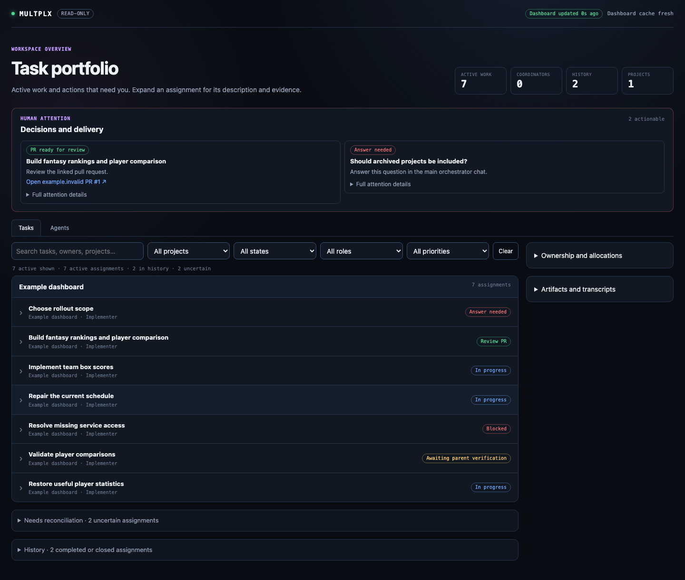
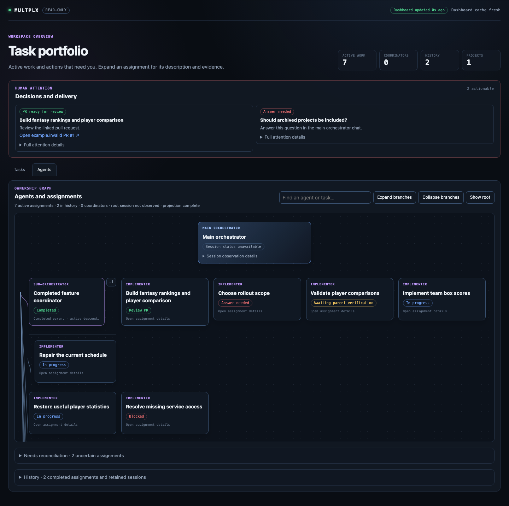
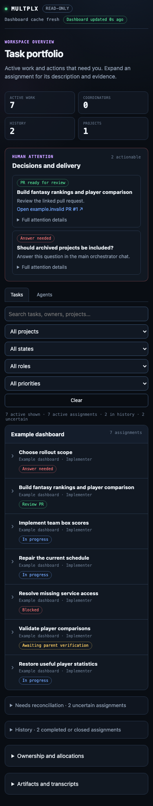
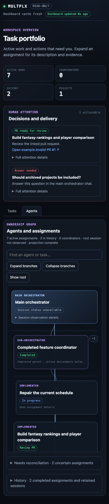

# Active dashboard verification

The October 2026 repair addresses completed work mixed with active assignments, machine IDs and full worker prompts as titles, competing status badges, stale ready-PR receipts, and missing ordinary worker descendants.
The source observations were human screenshots and supplied transcripts; private task IDs, paths and transcript contents are not reproduced here.
All retained browser examples use the synthetic `tests/fixtures/viz/dashboard.mjs` portfolio.

## Presentation contract

Tasks and Agents default to active work, with completed or closed assignments in initially collapsed History.
Uncertain observations have their own initially collapsed Needs reconciliation group and visible count.
Unanswered human questions, blocking dependencies and actionable current PR reviews remain active even when implementation is complete.
The ownership graph retains completed ancestors as context when they have active descendants.
A worker's done report says Awaiting parent verification; implementation completion and a matched human-merged PR are separate evidence facts.
Agent availability, observation quality, session references, paths, attempts and workflow mechanics live in assignment details.
The root card shows only session availability, with dashboard cache and observation diagnostics in a disclosure.
Dashboard update age describes the viewer's collection, without asserting that every agent is fresh.

Human Attention remains visible on both tabs.
A question names the requested answer and the main orchestrator chat as its reply destination.
A PR card exposes its actual repository and PR-number link immediately.
Descriptions and complete legacy task text remain available in bounded disclosures, rendered as literal text.
Project selectors retain stable IDs internally and display project names, with checkout paths only to distinguish duplicate names.

Forge observations supersede stored ready receipts.
Merged and closed observations require an exact published-head match before moving the current task revision into history.
A failed or missing bounded forge observation suppresses an unverified review action and retains the task for reconciliation.
Reopening a current ready PR restores the review action; merging a PR never clears an unrelated human question.
The dashboard is GET-only and does not alter task state, publication receipts or operational homes.

## Browser evidence






`tests/viz-dashboard-browser-check.mjs` serves only repository UI assets on an ephemeral loopback port and intercepts state requests with synthetic fixtures.
It never starts an operational home, authenticates a provider or contacts a real forge.
The Chromium desktop (1440 by 900) and mobile (390 by 844) cases verify seven active assignments, two historical assignments and two uncertain assignments, independent of retained session count.
They cover search and state filters, initial disclosures, keyboard skip navigation, visible PR links, question routing, long and sparse titles, nested branch expansion, terminal parent context, exact historical task opening, programmatic merged/closed/reopened PR refresh, agent/task state mismatch, final descendant scroll reachability and absence of horizontal page overflow.
The retained [browser result](viz-active-dashboard-browser-results.json) records these deterministic results.

Run the isolated browser check with an existing Playwright installation:

```sh
MX_PLAYWRIGHT_MODULE=/absolute/path/to/playwright/index.mjs \
MX_VIZ_BROWSER_OUTPUT=/tmp/mx-viz-dashboard-browser \
node tests/viz-dashboard-browser-check.mjs
```

The ordinary `tests/mx-viz.test.sh` gate runs the real client selectors, attention renderer and graph normalization tests without an installed browser.
The additional graph fixture verifies two levels of registered standing-worker homes and rejects an unvalidated parent route.
The selector fixture verifies that an old merged head cannot complete a newer delivery revision.
The existing `tests/viz-browser-check.mjs` remains the service-backed scale, polling and artifact acceptance runner.

## Validation boundary

The evidence above proves fixture-based browser behavior, not a live private portfolio or provider session.
Programmatic forge state and nested-home reading are separately covered by the backend's deterministic domain and service tests.
No private runtime migration, installation refresh, operational task mutation or PR merge is included in this repair.
